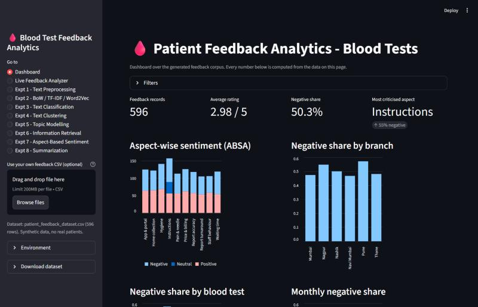
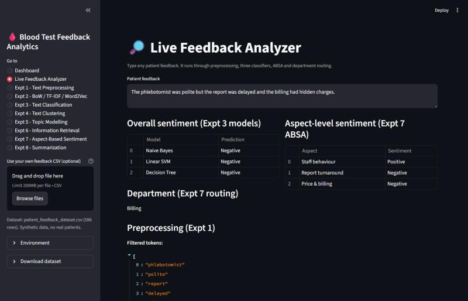
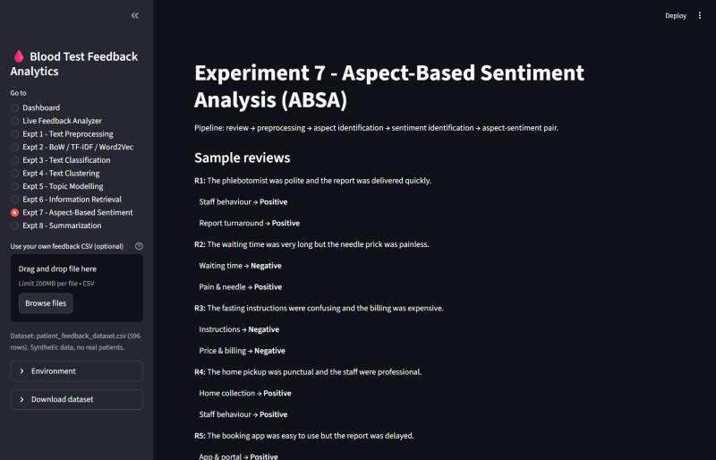

# Patient Feedback Analytics for Blood Tests

An interactive NLP app that turns free-text patient feedback about blood tests into answers a lab manager can act on: **how do patients feel, about which part of the service, and which department should fix it?**

Built with Python, scikit-learn, NLTK, Gensim and Streamlit as a single-file app (`patient_feedback_app.py`) covering eight NLP experiments, plus a dashboard and a live analyzer that tie them together.



## What it does

| Page | Technique |
|------|-----------|
| **Dashboard** | KPIs, negative share by branch / test / month, aspect-wise sentiment |
| **Live Feedback Analyzer** | Type any review and get overall sentiment (3 models), aspect sentiment, department routing and the preprocessing output |
| **Expt 1: Preprocessing** | Lowercase, punctuation removal, tokenization, stopwords, stemming, lemmatization, POS tagging |
| **Expt 2: Features** | Bag of Words vs TF-IDF vs Word2Vec |
| **Expt 3: Classification** | Naive Bayes vs Linear SVM vs Decision Tree, with confusion matrices and 5-fold cross-validation |
| **Expt 4: Clustering** | Hierarchical (dendrogram) vs DBSCAN |
| **Expt 5: Topic modelling** | LDA vs NMF |
| **Expt 6: Information retrieval** | TF-IDF + named entity recognition + cosine similarity |
| **Expt 7: Aspect-based sentiment** | Aspect-sentiment pairs with negation handling, plus department routing |
| **Expt 8: Summarization** | TextRank (extractive) vs BART (abstractive), evaluated with ROUGE |

| Live analyzer | Aspect-based sentiment |
|---|---|
|  |  |

For example, *"The phlebotomist was polite but the report was delayed and the billing had hidden charges."* is classified Negative overall, but the aspect view shows **Staff behaviour: Positive**, **Report turnaround: Negative** and **Price & billing: Negative**, and routes the review to Billing.

## Run it

```bash
pip install -r requirements.txt
streamlit run patient_feedback_app.py
```

On first run the app downloads the small NLTK packages it needs (tokenizer, stopwords, WordNet, POS tagger). Everything else works offline.

**Optional extras** (the app degrades gracefully without them):

```bash
pip install spacy rouge-score transformers torch
python -m spacy download en_core_web_sm
```

- spaCy gives statistical NER in Expt 6 (a rule-based fallback is used otherwise).
- `rouge-score` gives the official ROUGE implementation (a built-in one is used otherwise).
- `transformers` + `torch` enable the BART summary in Expt 8 (downloads a model of roughly 1.2 GB or more).

## Data

- `patient_feedback_dataset.csv` has 596 synthetic feedback records generated with a fixed seed.
- `ir_documents.csv` has 12 branch incident reports used by Expt 6.

No real patient data is used. If a CSV is missing the app regenerates it, and you can upload your own CSV with the same columns from the sidebar.

## Results

| Model (Expt 3) | Test accuracy | 5-fold CV macro F1 |
|---|---|---|
| Linear SVM | 0.967 | 0.992 |
| Naive Bayes | 0.955 | 0.965 |
| Decision Tree | 0.927 | 0.891 |

Rule-based ABSA against the generated aspect labels: precision 0.969, recall 1.000, F1 0.984. A plain document-level lexicon classifier reaches 79.4%.

## Limitations

- **The data is synthetic and template-generated.** The scores above are optimistic upper bounds. Real, messier feedback would score lower.
- **ABSA is rule-based.** It uses a hand-built sentiment lexicon, clause splitting and simple negation handling, so it misses sarcasm, unseen vocabulary and aspects without keywords. A fine-tuned transformer would do better on real data.
- **Word2Vec** is trained on a small, repetitive corpus, so the neighbours reflect phrase co-occurrence more than meaning.
- **Retrieval is lexical.** TF-IDF will not match "late" with "delayed"; embedding-based retrieval would.
- **Summaries are not for clinical use.** Abstractive models can paraphrase or drop values and flags. Always keep the original and have a clinician verify.

## Possible next steps

- Evaluate on a real public review dataset.
- Compare the TF-IDF baselines with a fine-tuned DistilBERT classifier.
- Use sentence embeddings for retrieval and clustering.
